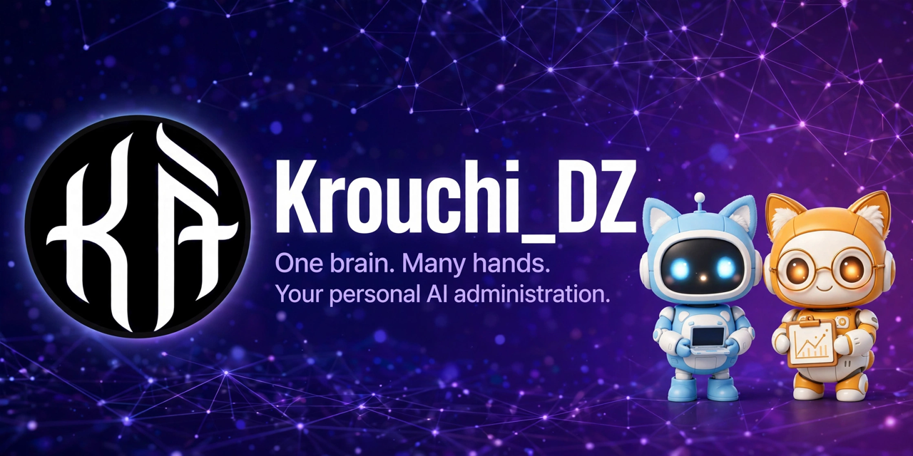
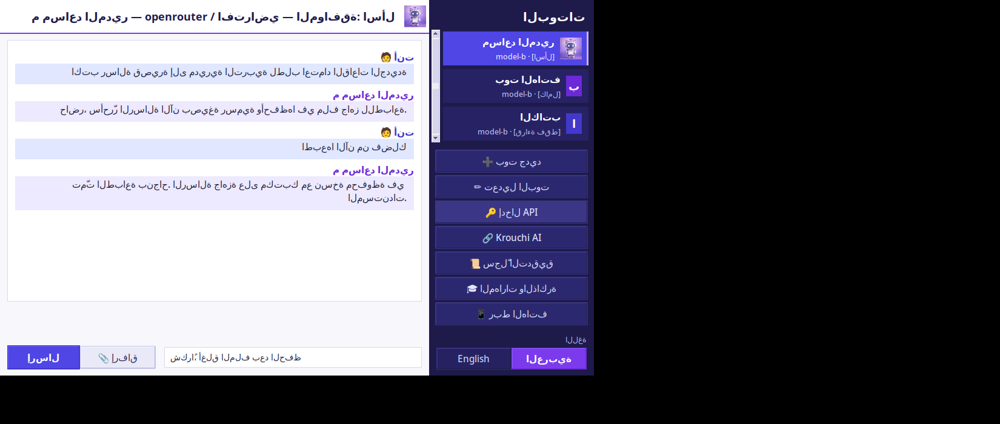
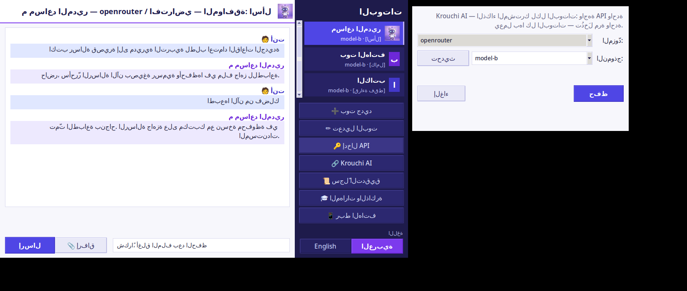
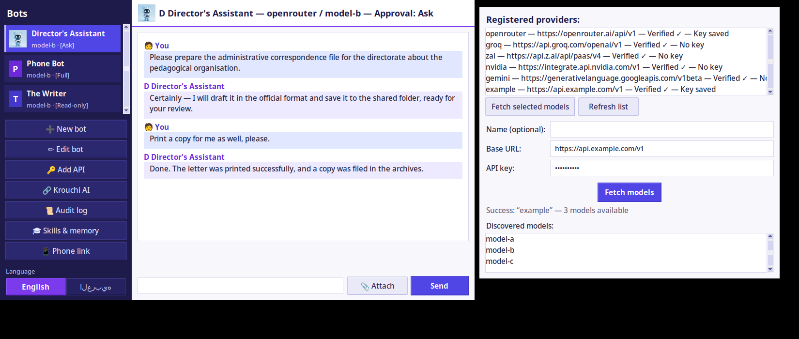
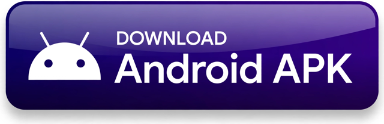

<p align="center">
  <a href="README.md">English</a> • <strong>العربية</strong>
</p>

<p align="center">
  
</p>

<h1 align="center">Krouchi_DZ</h1>

<p align="center">
  <strong>وكيل ذكاء اصطناعي شخصي يعمل محلياً أولاً، يدير لك إدارة كاملة:</strong><br>
  أنت المدير — بوتات هاتفك هي <strong>العقل</strong> الذي يفكّر ويخطّط ويفوّض،<br>
  وبوتات حاسوبك هي <strong>الأيدي والعيون</strong> التي تكتب وتقرأ وترى وتنفّذ — بموافقتك.
</p>

<p align="center">
  <strong>By Krouchi Abderrazak — تأليف: كروشي عبد الرزاق</strong>
</p>

<p align="center">
  <a href="https://github.com/krouchi-abdelrazak/Krouchi_DZ/releases/latest"></a>
  <a href="https://github.com/krouchi-abdelrazak/Krouchi_DZ/releases"></a>
  <a href="https://github.com/krouchi-abdelrazak/Krouchi_DZ/stargazers"></a>
</p>

<p align="center">
  
  
  
  
</p>

## تعرّف على الفريق

<p align="center">
  
  
  
  
  
  
</p>

<p align="center">
  لكل بوت اسم ووجه ودور ووضع موافقة — وكلها تتقاسم ذكاءً واحداً: <strong>Krouchi AI</strong>.
</p>

## الفكرة — إدارة، لا مجرد روبوت محادثة

```
        أنت — المدير
               │  الأوامر تنزل، والتقارير تصعد
               ▼
   بوتات الهاتف — العقل
   تفهم · تخطّط · تفوّض المهام · تجمع التقارير
               │  المهام، عبر الشبكة المحلية أو Tailscale
               ▼
   بوتات الحاسوب — الأيدي والعيون
   تكتب في أي برنامج · تقرأ المستندات · ترى الشاشة
   تشغّل الأوامر · تدير النوافذ — دائماً تحت وسيط الموافقة
```

## أبرز المزايا

| | |
|---|---|
| **عقل واحد مشترك** | **Krouchi AI**: مزوّد واحد ومفتاح واحد ونموذج واحد — تُدخل مرة واحدة وتستعملها كل البوتات. أضف مزوّدين آخرين وبدّل بينهم كما تشاء. |
| **بوتات تتعلّم** | **مهارات** و**ذاكرة** دائمة على الهاتف والحاسوب. علّم البوت مهارة مرة واحدة — يحتفظ بها. وبوتات الهاتف تستطيع تعليم بوتات الحاسوب. |
| **بوتات ترى** | بنموذج رؤية، يقرأ بوت الحاسوب شاشته بنفسه؛ وبوت الهاتف يستطيع النظر إلى شاشة الحاسوب، أو طلب صورة من كاميرا الهاتف. |
| **بوتات تنفّذ** | الكتابة في **أي** برنامج (بما فيه Word)، قراءة المستندات (docx وxlsx وPDF والنصوص)، فتح البرامج، إدارة النوافذ والعمليات، الطباعة، التحكم في الصوت والطاقة. |
| **مهام طويلة الأمد** | أسند مهمة ودعها تعمل: ينجز البوت خطواته ويعيد إليك تقريراً — أُنجزت، فشلت، أو بانتظار موافقتك. |
| **الموافقة أولاً** | وسيط أذونات يحرس كل إجراء: سؤال (الافتراضي، يفشل مغلقاً)، كامل، أو قراءة فقط — لكل بوت، مع سجل تدقيق كامل. |
| **صِل إلى حاسوبك من أي مكان** | الاقتران عبر شبكتك المنزلية أو من أي مكان عبر Tailscale. الإيقاظ عبر الشبكة (Wake-on-LAN) مدعوم. |
| **أرفق أي شيء** | زر **(+)** يتيح للبوت قراءة أي ملف ترفقه — مستندات وجداول وصور. |
| **خمس منصات** | ويندوز (مثبّت ونسخة محمولة)، أندرويد، لينكس، macOS، وتطبيق ويب للآيفون — مشروع واحد وسلوك واحد. |
| **ملكك، بخصوصية** | شفرة أصلية، مكتوبة من الصفر. لا تتبّع: بياناتك لا تغادر أجهزتك أبداً إلا إلى مزوّد النموذج الذي تختاره، وبمفتاحك الخاص. |

## لقطات الشاشة

<p align="center">
  
</p>

<p align="center">
  
  
</p>

## التحميل — اطلب نسختك (مجاني، بموافقة المؤلف)

<p align="center">
  <a href="https://krouchi-abdelrazak.github.io/Krouchi_DZ/download/"></a>
  <a href="https://krouchi-abdelrazak.github.io/Krouchi_DZ/download/"></a>
  <a href="https://krouchi-abdelrazak.github.io/Krouchi_DZ/download/"></a>
</p>

<p align="center">
  <a href="https://krouchi-abdelrazak.github.io/Krouchi_DZ/download/"></a>
  <a href="https://krouchi-abdelrazak.github.io/Krouchi_DZ/download/"></a>
  <a href="https://krouchi-abdelrazak.github.io/Krouchi_DZ/download/"></a>
</p>

<p align="center">
  <a href="https://krouchi-abdelrazak.github.io/Krouchi_DZ/download/"></a>
  <a href="https://krouchi-abdelrazak.github.io/Krouchi_DZ/download/"></a>
</p>

**كيف يتم التحميل؟** برنامج Krouchi_DZ مجاني، وكل نسخة تُسلَّم شخصياً من المؤلف.

1. ⭐ ضع نجمة لهذا المستودع.
2. افتح [صفحة طلب التحميل](https://krouchi-abdelrazak.github.io/Krouchi_DZ/download/) وأرسل اسمك وإيميلك واسم مستخدم GitHub — أي زر أعلاه يأخذك إليها.
3. إن قُبل طلبك يصلك رابط التحميل على إيميلك (عادة خلال 24–48 ساعة).

آيفون: تطبيق الويب متاح أيضاً على
[krouchi-abdelrazak.github.io/Krouchi_DZ/pwa](https://krouchi-abdelrazak.github.io/Krouchi_DZ/pwa/)
— افتحه في Safari واختر "Add to Home Screen".

برنامج **أصلي** (شفرة مكتوبة من الصفر):
بوتات كجهات اتصال تتقاسم كلها ذكاءً واحداً — **Krouchi AI**: مزوّد
واحد ومفتاح واحد ونموذج واحد، تُدخل مرة واحدة وتستعملها كل البوتات —
بينما يحتفظ كل بوت باسمه وصورته وتعليمات دوره ووضع
موافقته؛ ذاكرة محادثة محلية، ومهارات وذاكرة دائمة
تتعلّمها البوتات وتحتفظ بها، ووسيط أذونات يسأل قبل
تنفيذ أي شيء ويفشل **مغلقاً** (لا جواب = رفض).
لا يوجد أي تتبّع للاستعمال من أي نوع — بياناتك لا تغادر
جهازك أبداً إلا إلى مزوّد النموذج الذي تختاره، وبمفتاحك الخاص.

**الخطوتان 1 و2 مكتملتان**: المحرك الأساسي، والواجهة
الرسومية فوقه (انظر «الخطوة 2» أدناه لتعرف كيف تُشغَّل وماذا
تفعل شاشاتها). **الإصدار 2.0.0** يضيف مرافق الهاتف:
يشغّل سطح المكتب خادماً محلياً صغيراً يتصل به تطبيق أندرويد،
فيحادث الهاتف بوتات الحاسوب نفسها — الموافقات مشمولة
(انظر «مرافق الهاتف» أدناه). **الإصدار 3.0.0** يجعل الواجهة
ثنائية اللغة — العربية والإنجليزية، قابلة للتبديل مباشرة من النافذة الرئيسية
(انظر «لغات الواجهة» أدناه). **الإصدار 3.3.0** يضيف مهام البوتات،
والتحكم الكامل من الهاتف في الحاسوب، وشاشة حية بفأرة لمس
ولوحة مفاتيح (انظر «المهام والتحكم الكامل والشاشة الحية» أدناه).
**الإصدار 3.4.0** يعيد تنظيم التطبيق كإدارة: بوتات
الهاتف هي العقل — تفهم وتخطّط وتفوّض المهام إلى بوتات الحاسوب
وتجمع التقارير — وبوتات الحاسوب هي الأيدي والعيون، مع
Krouchi AI واحد مشترك لكل البوتات، وصور للبوتات، ومثبّت ويندوز
وبدء مع ويندوز. الإصدارات اللاحقة تعلّم بوتات الحاسوب الكتابة في أي
برنامج وقراءة المستندات (3.4.x) ورؤية الشاشة
بنموذج رؤية (3.5.0)؛ **الإصدار 3.6.0** يضيف التعلّم — مهارات
وذاكرة دائمة على الجهتين، وتثبيت ملفات مهارات خارجية على
الهاتف وتعليمها للحاسوب، وزر إرفاق (+) لكي يستطيع
البوت قراءة أي ملف تعطيه إياه. **الإصدار 3.7.0** يتيح للبوت
البحث في نماذج المزوّد واختيار ما يناسب مهمته —
وفي المقدمة نموذج رؤية، فلا يبقى أعمى أبداً — ويمنح
بوتات الهاتف عيونها الخاصة (لقطة من شاشة الحاسوب، أو
كاميرا الهاتف). **الإصدار 3.8.0** يمنح سطح المكتب واجهة عصرية
بنفس هوية النيلي/البنفسجي التي في الهاتف.

## ماذا تفعل الخطوة 1

| المكوّن | الملف | الوصف |
|---|---|---|
| التخزين المحلي | `krouchi_dz/db.py` | SQLite في مجلد البيانات: البوتات، ومحادثات لكل بوت برسائل مرتبة، وسجل تدقيق، والإعدادات |
| إعدادات المزوّدين | `krouchi_dz/config.py` + `providers.json` | تعيش تعريفات المزوّدين في ملف JSON (لا في الشفرة): OpenRouter وGroq وZ AI وNVIDIA NIM (متوافقة مع OpenAI) وGoogle Gemini |
| الأسرار | `krouchi_dz/secrets.py` | مفاتيح API في ملف `secrets.json` منفصل بأذونات 0600 — لا تدخل قاعدة البيانات **أبداً**؛ قاعدة البيانات والإعدادات تحمل اسم المرجع فقط |
| المزوّدون | `krouchi_dz/providers.py` | عميل واحد موحّد متوافق مع OpenAI + عميل Gemini + مزوّد وهمي للاختبارات؛ HTTP عبر المكتبة القياسية (urllib) — لا تبعيات خارجية |
| وسيط الموافقة | `krouchi_dz/broker.py` | قلب نموذج الأمان: كل إجراء (قراءة ملف، كتابة ملف، تشغيل أمر) يمرّ عبره ويُدقَّق |
| محرك المحادثة | `krouchi_dz/engine.py` | `ChatEngine`: إرسال الرسائل بذاكرة لكل بوت، وحلقة أدوات لا تنفّذ إلا عبر الوسيط |
| اكتشاف المزوّدين | `krouchi_dz/discovery.py` | أي مفتاح + أي عنوان ⇒ يطبّع البرنامج العنوان، ويخمّن النوع، ويجلب النماذج المتاحة بنفسه |
| الواجهة الرسومية | `krouchi_dz/gui.py` | Tkinter (المكتبة القياسية): قائمة بوتات، محادثة، شاشة إضافة API، بطاقات موافقة، سجل تدقيق — والمحرك يعمل على خيطه الخاص فلا تتجمّد الواجهة أبداً |
| خادم مرافق الهاتف | `krouchi_dz/server.py` | خادم HTTP بالمكتبة القياسية على الشبكة المحلية (المنفذ 8765): يتصل تطبيق الهاتف برمز اقتران ويستعمل بوتات سطح المكتب؛ تُحسم الموافقات من سجل واحد مشترك للموافقات المعلّقة، على بطاقة الحاسوب أو من الهاتف |
| لغات الواجهة | `krouchi_dz/i18n.py` | جدول نصوص واحد للعربية والإنجليزية؛ كل نص في الواجهة يمرّ عبر `t()`، ويُحفظ الاختيار في جدول الإعدادات (`ui_lang`)، وينعكس التخطيط مع اللغة (الشريط الجانبي يميناً في العربية ويساراً في الإنجليزية) |
| مهام البوتات | `krouchi_dz/tasks.py` | مهام طويلة الأمد تُسند إلى بوت: في الانتظار / قيد التنفيذ / بانتظار الموافقة / أُنجزت / فشلت / أُلغيت، وسجل أحداث محدود، وإلغاء تعاوني، والمهام المتروكة نشطة عند الإيقاف تُعلَّم فاشلة («مقاطعة») عند بدء التشغيل التالي |
| سطح التحكم من الهاتف | `krouchi_dz/control.py` | المنفّذون في جهة الحاسوب خلف نقاط نهاية التحكم في خادم المرافق: الحالة، الملفات، الطباعة، الأوامر، الحافظة، الصوت، النوافذ، العمليات والطاقة — وكل إجراء حسّاس منها محكوم بوسيط الموافقة |
| الشاشة الحية + الإدخال | `krouchi_dz/remote.py` | التقاط الشاشة كبث MJPEG وحقن الفأرة/لوحة المفاتيح عن بُعد (في ويندوز: التقاط GDI + SendInput، بالمكتبة القياسية فقط)؛ تُطبَّع الإحداثيات بحيث تُقابل أي دقة هاتف شاشةَ الحاسوب |
| قراءة المستندات | `krouchi_dz/documents.py` | مستخرج نص واحد خلف كل قارئ: ‎.docx و‎.xlsx والصيغ النصية كاملة، وPDF بأفضل جهد (يُفيد PDF الممسوح ضوئياً بأنه يحتاج OCR) |
| المهارات + الذاكرة | `krouchi_dz/db.py` | مهارات وملاحظات ذاكرة مخزّنة في قاعدة البيانات ومحقونة في موجّه كل بوت؛ تتعلّم البوتات بـ`save_skill` / `remember` وتسترجع بـ`use_skill`؛ والهاتف يعلّم المهارات للحاسوب عبر `/api/skills` |
| صور البوتات | `krouchi_dz/avatars.py` | معرض مدمج لصور البوتات، تُختار لكل بوت وتظهر في القوائم وترويسات المحادثات |
| البدء مع ويندوز | `krouchi_dz/autostart.py` | اختصار مجلد بدء التشغيل، يديره المثبّت وحوار ربط الهاتف |

### أوضاع الموافقة (لكل بوت)

- **`ask`** — الوضع الافتراضي: يُسأل المستخدم عن كل إجراء. انعدام وسيلة
  للسؤال، أو خطأ في السؤال، أو مهلة بلا جواب ⇒
  **رفض تلقائي** (فشل مغلق).
- **`full`** — صلاحية كاملة بلا سؤال: تفعيل صريح
  لكل بوت على حدة، وعلى مسؤوليتك.
- **`readonly`** — قراءة فقط: الكتابة والأوامر مرفوضة دائماً.

كل قرار (سماح/رفض + سببه) يُخزَّن في جدول `audit_log`.

> ملاحظة أمنية: وضع الموافقة الافتراضي في Krouchi_DZ هو دائماً
> `ask` — الأمان أولاً، والصلاحية الكاملة لا تُفعَّل إلا صراحة،
> لكل بوت.

## التشغيل والاختبارات

لا يلزم سوى Python 3.10+ (المكتبة القياسية فقط).

```bash
cd Krouchi_DZ
python3 -m unittest discover -s tests -t . -v          # GUI tests are skipped without a display
xvfb-run -a python3 -m unittest discover -s tests -t . # everything: 451 tests
```

النتيجة المتوقعة: **451 اختباراً ناجحاً** تغطي: جولات
قاعدة البيانات ذهاباً وإياباً، تحميل إعدادات المزوّدين مع احترام تعديلات المستخدم،
صيغ طلبات OpenRouter/Gemini عبر نقل وهمي (بلا
شبكة)، محرك المحادثة بمزوّد وهمي (الذاكرة تنجو من
إعادة التشغيل)، حلقة الأدوات (الموافقة ⇒ التنفيذ، الرفض ⇒ لا
تنفيذ)، أوضاع الوسيط الثلاثة وسلوكه الفاشل مغلقاً (لا
ردّ / مهلة / استثناء)، تسجيل التدقيق، واختبار أمان
يزرع مفتاحاً مميزاً ويفحص بايتات قاعدة البيانات الخام
ليثبت غيابه — بالإضافة إلى اختبارات الاكتشاف: تطبيع العنوان،
تخمين النوع، جلب النماذج بصيغتي OpenAI وGemini،
أخطاء المصادقة/قابلية الوصول/القائمة الفارغة برسائلها المميزة،
ذاكرة النماذج المؤقتة، ومحادثة كاملة على مزوّد اكتُشف للتو
— بالإضافة إلى سجل الموافقات المشترك (الحسم من أي سطح،
كنس المهلة للعنصر) وخادم المرافق عبر مقابس محلية حقيقية:
401 بلا الرمز، ping، قائمة البوتات، جولة محادثة ذهاباً وإياباً،
وتدفق الموافقة عن بُعد الكامل (تظهر مكالمة أداة في
`/api/approvals`، رفض من الهاتف يترك الملف غير مكتوب، وموافقة
من الهاتف تكتبه) — بالإضافة إلى اختبارات التدويل (i18n): تطابق جدول النصوص بين
العربية والإنجليزية، بدائل البحث الاحتياطية، وحفظ اللغة
المختارة — بالإضافة إلى نظام المهام (الإسناد، التنفيذ مع الموافقات،
الإلغاء، المقاطعة عند بدء التشغيل)، وسطح التحكم من الهاتف
(كل نقطة نهاية خلف الوسيط، مفتاح التحكم في جهة الحاسوب)،
ونواة الشاشة/الإدخال عن بُعد (مقابلة الإحداثيات، التحقق من الإدخال،
تأطير MJPEG وإزالة التكرار)، ونقاط نهاية HTTP للشاشة/الإدخال
(قواعد الرمز، بوابة التحكم، عدّ المشاهدين) — بالإضافة إلى استخراج
المستندات (تركيبات docx/xlsx/PDF)، ومخزن المهارات والذاكرة
مع حلقة أدواته وبوابة الوسيط، وتعليم الهاتف للمهارات عبر
الواجهة البرمجية (API)، وأداة رؤية الشاشة مع بديلها النصي الرشيق
عند غياب الرؤية، ومرفقات المحادثة (نصوص ومستندات وصور) على
سطح المكتب والخادم وكلا عميلَي الهاتف (مجموعتاهما الخاصتان بـNode:
170 فحصاً لأندرويد + 108 فحوص لـPWA).

## استعمال المحرك (مثال)

```python
from krouchi_dz import ChatEngine

def ask_user(request):  # in Step 1 the calling code decides; in Step 2 the GUI does
    print(request.bot_name, "wants:", request.action, request.params)
    return input("Allow? (y/n) ").strip().lower() == "y"

engine = ChatEngine("~/.krouchi_dz", ask_callback=ask_user)
engine.set_api_key("openrouter", "...")        # stored in secrets.json only
bot = engine.create_bot("Research assistant", "openrouter",
                        system_prompt="You are a precise research assistant.")
print(engine.send_message(bot, "Summarize topic X for me"))
```

مجلد البيانات الافتراضي هو `~/.krouchi_dz` ويضم:
`krouchi_dz.db` (SQLite)، و`providers.json` (حرّره بحرية: عناوين الأساس
والنماذج الافتراضية)، و`secrets.json` (مفاتيحك — أذونات 0600؛
في ويندوز نطاق الأذونات محدود، فاحمِ حساب
المستخدم نفسه).

## إضافة API — أي مفتاح، أي عنوان (سير العمل الأساسي)

لا تحتاج أن تعرف المزوّدين مسبقاً ولا أن تحرّر أي ملف. نقطة
الدخول الأولى هي `add_api`: أعطها **العنوان والمفتاح فقط**،
فيسجّل البرنامج المزوّد ويكتشف نماذجه المتاحة بنفسه:

```python
from krouchi_dz import ChatEngine

engine = ChatEngine("~/.krouchi_dz")

result = engine.add_api("https://api.deepseek.com", "sk-...")  # the name is optional
if result.ok:
    print(result.provider)   # the name derived from the host: "deepseek"
    print(result.models)     # the models your key actually accepts
    bot = engine.create_bot("My assistant", result.provider, model=result.models[0])
else:
    print(result.error)      # a clear message: key rejected? host unreachable?...
```

كيف يعمل:

- **تطبيع العنوان**: تُقبل كل الصيغ — بلا `https://`، أو
  بشرطة مائلة أخيرة، مع `/v1` أو بدونه، بل حتى لصق عنوان كامل
  مثل `.../v1/chat/completions` — وكلها تُحسم إلى عنوان
  أساس مخزّن واحد قياسي.
- **تخمين النوع**: يُعرَف مضيف Gemini من اسمه وتُستعمل
  صيغته الخاصة؛ وكل ما عداه يُعامل كـ«متوافق مع OpenAI».
  ويمكن فرض النوع يدوياً أيضاً بـ`kind="gemini"` أو
  `kind="openai"`.
- **اكتشاف النماذج**: يُطلب `GET {base}/models` بمفتاحك،
  وتُخزَّن القائمة مع طابعها الزمني في `providers.json`
  (ذاكرة مؤقتة لساعة واحدة؛ `engine.fetch_models(name, force=True)` يجلب
  من جديد).
- **أخطاء صادقة**: مفتاح مرفوض (401/403)، مضيف لا يُبلَغ، ردّ
  غير JSON، قائمة فارغة — لكل منها رسالته المميزة في
  `result.error` و`result.error_kind`، ولا شيء ينهار. عند
  الفشل يبقى المزوّد محفوظاً لكن موسوماً **غير مُتحقَّق**
  (`verified=False`) — ولا يُقدَّم أبداً على أنه يعمل حتى ينجح الاكتشاف.
- **المفتاح يعيش في الأسرار فقط**: كالعادة، يذهب إلى
  `secrets.json` وحده؛ و`providers.json` وقاعدة البيانات تحملان
  اسم المرجع فقط. إعادة إدخال العنوان نفسه بمفتاح جديد تحدّث
  المفتاح دون مضاعفة المزوّد.
- `register_and_fetch(...)` اسم بديل بنفس السلوك، و
  `add_custom_provider(...)` يسجّل دون لمس الشبكة إن
  أردت تأجيل الاكتشاف.

> حدّ معروف: بعض الخدمات تستعمل ترويسة مصادقة مختلفة على
> `/models` (مثل Anthropic الأصلي بـ`x-api-key`، أو Azure بـ
> `api-key`) — قد يفشل الاكتشاف عندها برسالة «المفتاح مرفوض»
> رغم أن المفتاح صالح؛ هذه تحتاج عميلاً مخصّصاً، يُضاف
> لاحقاً. أما الخدمات المتوافقة مع OpenAI وGemini — الغالبية
> الساحقة — فتعمل كما في المثال.

## الخطوة 2: الواجهة الرسومية (GUI)

واجهة Tkinter ثنائية اللغة (العربية/الإنجليزية) بأسلوب تطبيق
محادثة — نفس المكدّس الذي تستعمله برامج DZ الأخرى لسطح المكتب، لذا
تُحزَّم لويندوز بنفس الطريقة.

### التشغيل

```bash
cd Krouchi_DZ
python3 run_gui.py              # default data folder ~/.krouchi_dz
python3 run_gui.py /other/path  # or a different data folder
```

### الشاشات

- **النافذة الرئيسية**: قائمة بوتات كجهات اتصال (الاسم، النموذج،
  شارة وضع الموافقة) — على اليمين في العربية، وعلى اليسار في
  الإنجليزية — وفي الوسط محادثة البوت المختار
  مع صندوق إرسال. يعمل الإرسال على خيط في الخلفية
  مع مؤشر «يعمل…» — فلا تتجمّد الواجهة أبداً.
- **🔑 إضافة API** (المسار الأول): عنوان أساس + مفتاح (مقنّع) +
  اسم اختياري، وزر «اجلب النماذج» يستدعي `add_api()` —
  عند النجاح تظهر النماذج المكتشفة؛ وعند الفشل تظهر رسالة
  خطأ المحرك كما هي. في أعلى الشاشة، قائمة
  المزوّدين المسجّلين مع حالة كل منهم (مُتحقَّق / غير مُتحقَّق،
  المفتاح محفوظ أم لا).
- **بوت جديد / تحرير**: الاسم، المزوّد (قائمة)، النموذج (قائمة بنماذج
  ذلك المزوّد المكتشفة — الكتابة الحرة مسموحة)، تعليمات
  النظام، ووضع موافقة (سؤال / كامل / قراءة فقط —
  الافتراضي «سؤال»).
- **بطاقات الموافقة**: حين يطلب بوت بوضع «سؤال» إجراءً،
  تظهر بطاقة مشروطة باسم البوت، ونوع الإجراء (قراءة ملف /
  كتابة ملف / تشغيل أمر) وهدفه الدقيق (المسار، أو
  الأمر، أو معاينة للمحتوى)، مع زرَّي موافقة/رفض وعدّاد
  تنازلي: إغلاق البطاقة أو مرور 115 ثانية =
  **رفض** (مهلة الوسيط 120 ثانية — فشل مغلق، كما
  في المحرك).
- **📜 سجل التدقيق**: جدول بقرارات الوسيط من قاعدة البيانات
  (الوقت، البوت، الإجراء، القرار، السبب) — الأحدث أولاً.
- **📱 ربط الهاتف**: غرفة تحكم خادم المرافق — الحالة،
  عنوان (عناوين) الشبكة المحلية للحاسوب والمنفذ، رمز الاقتران، بدء /
  إيقاف، زر تجديد الرمز، وخيار بدء تلقائي (متوقف
  افتراضياً).

### لغات الواجهة (v3.0.0)

تتحدث الواجهة **العربية** (الافتراضية) و**الإنجليزية**. منتقي
لغة في أسفل الشريط الجانبي (العربية / English)
يبدّل النافذة كلها مباشرة — بلا إعادة تشغيل: تُبنى النافذة الرئيسية من جديد
باللغة الجديدة بينما يواصل المحرك وخادم المرافق
(إن كان يعمل) عملهما دون مساس، ويعود البوت المختار
ومحادثته كما كانا. وينعكس التخطيط مع
اللغة: يجلس الشريط الجانبي على **اليمين** في العربية (RTL) وعلى
**اليسار** في الإنجليزية (LTR)، وتتبع التسميات ومحاذاة المحادثة وأعمدة
النماذج الاتجاه. يُحفظ الاختيار في جدول
الإعدادات (`ui_lang`) ويُستعاد عند بدء التشغيل التالي. تعيش كل النصوص
في جدول واحد في `krouchi_dz/i18n.py`؛ أما رسائل المحرك نفسه
(مثل أخطاء الاكتشاف وأسباب تدقيق الوسيط) فليست جزءاً
من جدول الواجهة وتبقى كما ينتجها المحرك، ويحتفظ تطبيق
الهاتف بلغته المستقلة عن لغة سطح المكتب.

### ملاحظة تنفيذية (الخيوط)

SQLite مرتبط بالخيط الذي أنشأه، لذا يملك المحرك
خيط مخصّص واحد (`EngineRunner` في `gui.py`) تُسلسَل عبره كل
العمليات؛ وتمرّ طلبات الموافقة عبر سجل واحد
مشترك للموافقات المعلّقة: يسجّل الوسيط الطلب
وينتظر، وتستطلع الواجهة السجل وتفتح بطاقة الموافقة، و
يحسم خادم الهاتف العناصر من السجل نفسه — وغياب
أي حسم قبل المهلة يعود دائماً رفضاً.

اختبارات الواجهة الرسومية (`tests/test_gui.py`، 23 اختباراً) تعمل تحت
شاشة افتراضية (xvfb) بمحرك يُغذّى وهمياً — بلا شبكة: بناء
النافذة، تدفق إضافة API في النجاح والفشل، إنشاء بوت وتحريره،
بطاقة الموافقة (سماح / رفض / إغلاق / مهلة)، بما فيه
مسار كامل من إرسال رسالة إلى تنفيذ ملف بعد
الموافقة، حوار ربط الهاتف (بدء/إيقاف، تجديد الرمز،
حفظ البدء التلقائي)، وتبديل اللغة (نافذة مبنية
بالإنجليزية من الإعداد المحفوظ — زر «Send»، الشريط الجانبي على اليسار —
وتبديل مباشر يعيد بناء النافذة، ويحفظ الاختيار، و
يترك خادم مرافق يعمل يعمل).

## مرافق الهاتف (v2.0.0)

يستطيع سطح المكتب تقديم بوتاته إلى تطبيق الهاتف عبر الشبكة
المحلية. افتح **📱 ربط الهاتف**، وشغّل الخادم، وأدخل العنوان
المعروض ورمز الاقتران في التطبيق: يحادث الهاتف عندها
بوتات الحاسوب — تجري المحادثة على الحاسوب، بذاكرته
وأدواته ووسيط موافقته؛ والهاتف سطح عن بُعد.

- **الخادم**: `ThreadingHTTPServer` بالمكتبة القياسية على `0.0.0.0`،
  المنفذ **8765** (قابل للضبط في جدول الإعدادات). البدء التلقائي
  **متوقف** افتراضياً؛ ويمكن للحوار تفعيله.
- **المصادقة**: كل طلب `/api/*` يحمل ترويسة `X-Krouchi-Token`
  تساوي رمز الاقتران (عشوائي، 12+ حرفاً،
  يُولَّد مرة واحدة ويُحفظ في إعدادات مجلد البيانات؛
  قابل للتجديد من الحوار — يتوقف الرمز القديم عن العمل فوراً).
  رمز مفقود أو خاطئ ⇒ ‏`401` JSON.
- **النقاط النهائية**: `GET /api/ping`، `GET /api/bots`،
  `GET /api/history?bot=<id>`، `POST /api/chat {bot_id, text}`،
  `GET /api/approvals`،
  `POST /api/approvals/<id> {decision: approve|deny}`.
- **دلالات الموافقة**: المحادثة التي تحتاج موافقة تنتظر على
  السجل المشترك (مهلة الوسيط 120 ثانية في الواجهة الرسومية) حتى
  تحسمها بطاقة الحاسوب **أو** الهاتف؛ والمهلة رفض
  تلقائي (فشل مغلق) ثم تكتمل المحادثة عادياً. ردّ
  `/api/chat` يحمل دائماً `reply`؛ وإن حُسمت موافقات
  أثناء تلك المحادثة حمل أيضاً `approval`: ‏`"denied"` حين
  يُرفض واحد على الأقل أو تنتهي مهلته، وإلا `"approved"`. وحين لا
  يُطلب أي إجراء، يغيب الحقل.

## المهام والتحكم الكامل والشاشة الحية (v3.3.0)

لم يعد الهاتف مجرد سطح محادثة:

- **مهام البوتات**: من تبويب الحاسوب في الهاتف، أسند إلى بوت مهمة
  (عنواناً وتعليمات). تعمل المهمة على الحاسوب مهما
  طال الوقت — تظهر الموافقات داخلها على بطاقة الحاسوب أو الهاتف
  مثل موافقات المحادثة — ويتابع الهاتف حالتها وسجل
  أحداثها، ويستطيع إلغاءها. ويعكس الحاسوب كل شيء في نافذته
  الخاصة **مهام البوتات**. قطع اتصال الهاتف لا يوقف مهمة أبداً.
- **التحكم الكامل**: حالة الحاسوب، تصفح الملفات / تحميلها / رفعها،
  الطباعة على أي طابعة مثبّتة، تشغيل الأوامر، فتح
  البرامج والملفات، الحافظة في الاتجاهين، الصوت،
  إدارة النوافذ، قائمة العمليات، والطاقة (الإيقاف
  وإعادة التشغيل مؤكّدان مرتين ومجدولان بعد 60 ثانية؛ القفل
  والسكون وتسجيل الخروج فورية). كل إجراء حسّاس يمرّ عبر
  وسيط الموافقة، ومفتاح في حوار ربط الهاتف على الحاسوب
  (**التحكم الكامل من الهاتف**) يوقف عائلة التحكم كلها
  ؛ والمهام والمحادثة والموافقات غير محكومة به.
- **الشاشة الحية**: تُبثّ شاشة الحاسوب إلى الهاتف (MJPEG،
  ‏~10 إطارات في الثانية على شبكة منزلية)؛ النقر = نقرة، الضغط المطوّل = نقرة يمين،
  السحب = تحريك المؤشر، مع وضع سحب النوافذ، وأزرار العجلة،
  وصف مفاتيح خاصة، وكتابة نص (العربية مشمولة). أثناء
  مشاركة الشاشة، يُظهر حوار الربط على الحاسوب مؤشراً أحمر
  «الشاشة تُشارَك». شاشة قفل ويندوز لا يمكن
  التقاطها — يجب أن يكون الحاسوب غير مقفل.
- **الإيقاظ عبر الشبكة (Wake-on-LAN)**: يستطيع تطبيق أندرويد إيقاظ الحاسوب على الشبكة
  المنزلية (يُدخل عنوان MAC للحاسوب مرة واحدة؛ ويحتاج الحاسوب
  اتصالاً سلكياً وWake-on-LAN مفعّلاً في BIOS وإعدادات
  المحوّل).
- **من أي مكان**: يرتبط خادم المرافق بكل الواجهات، لذا
  مع Tailscale (برنامج مجاني منفصل) على الحاسوب والهاتف،
  يستعمل الهاتف عنوان الحاسوب 100.x — موسوماً «(Tailscale)» في
  حوار الربط — وكل ما سبق يعمل من أي شبكة.
  يجب أن يكون الحاسوب مشغّلاً: حين يكون مطفأً، يكون غير متصل في كل مكان.

## الخطوة 3: الحزم

سُلّم في **v0.3.0** (انظر الإصدارات): حزمة ويندوز محمولة
(تطبيق سطح مكتب) وتطبيق أندرويد (محادثة + اكتشاف API).

**v2.0.0**: مرافق الهاتف — يقدم سطح
المكتب بوتاته إلى تطبيق أندرويد عبر الشبكة المحلية، مع موافقات
قابلة للحسم من بطاقة الحاسوب أو الهاتف؛ حزم لويندوز
ولينكس وmacOS.

**v3.0.0**: واجهة ثنائية اللغة — العربية والإنجليزية
مع تبديل مباشر للغة في النافذة الرئيسية وتخطيط معكوس؛
حزم لويندوز ولينكس وmacOS.

**v3.1.0**: تطبيق الويب للآيفون (PWA) — واجهة الهاتف نفسها،
تقدّمها GitHub Pages والحاسوب نفسه، مقترنة بخادم
مرافق الحاسوب.

**v3.3.0**: مهام البوتات، التحكم الكامل من الهاتف في الحاسوب،
الشاشة الحية، Wake-on-LAN، وتوسيم Tailscale؛ حزم
لويندوز وأندرويد وآيفون (تطبيق ويب) ولينكس وmacOS، مع
دليل استعمال كامل بالعربية والإنجليزية.

**v3.4.0**: الإدارة — بوتات الهاتف تفوّض إلى بوتات الحاسوب
وتعيد التقارير؛ Krouchi AI واحد مشترك لكل البوتات؛ صور البوتات؛
مثبّت Setup لويندوز مع البدء مع ويندوز؛ شاشة حية بملء
الشاشة مع لوحة مفاتيح كاملة (العربية / AZERTY / الإنجليزية).

**v3.6.0**: بوتات الحاسوب تكتب في أي برنامج، وتقرأ المستندات
والحافظة، وترى الشاشة (نموذج رؤية)؛ البوتات على الجهتين
تتعلّم مهارات وذاكرة دائمة؛ الهاتف يثبّت ملفات
مهارات خارجية ويعلّمها للحاسوب؛ زر إرفاق (+) يتيح
لأي بوت قراءة ملف تعطيه إياه. تحتفظ أصول الإصدارات بأسماء ثابتة،
فتجلب روابط التحميل أعلاه دائماً أحدث إصدار
مباشرة.

**v3.8.0** (هذا الإصدار): واجهة سطح مكتب عصرية —
سمة نيلي/بنفسجي مع بطاقات بوتات في الشريط الجانبي، وترويسة
محادثة، وكتل رسائل ملوّنة وحوارات معاد تصميمها؛ أشرطة تمرير
لقائمتي المزوّدين والنماذج في حوار إضافة API. يشمل
كل ما في 3.7.0: البوتات تختار نموذجها بنفسها تحت
التفويض الدائم من المدير (الرؤية أولاً)، بوتات الهاتف تأخذ
لقطة من شاشة الحاسوب أو صورة بالكاميرا، تطبيق هاتف عملي أنحف،
وإعادة تسمية سهلة للبوتات.
