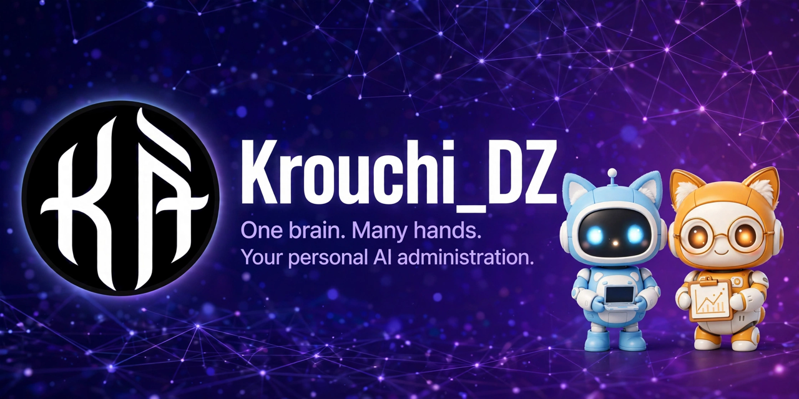
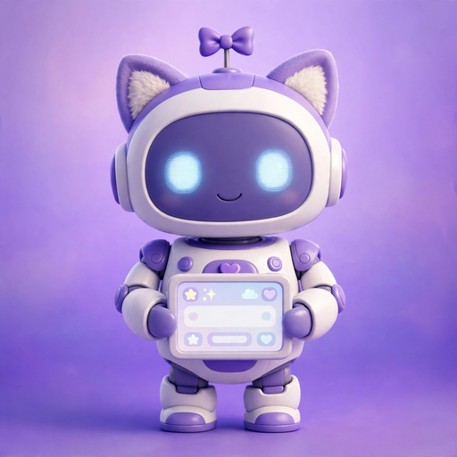
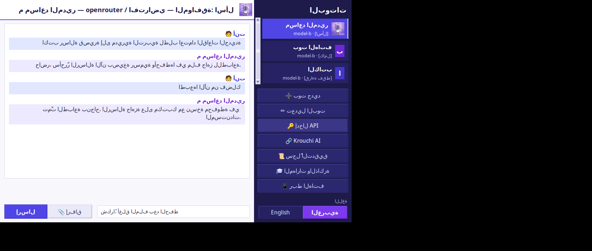
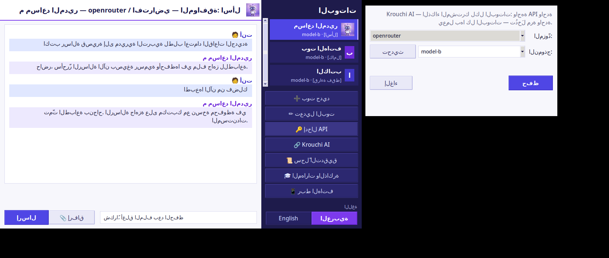
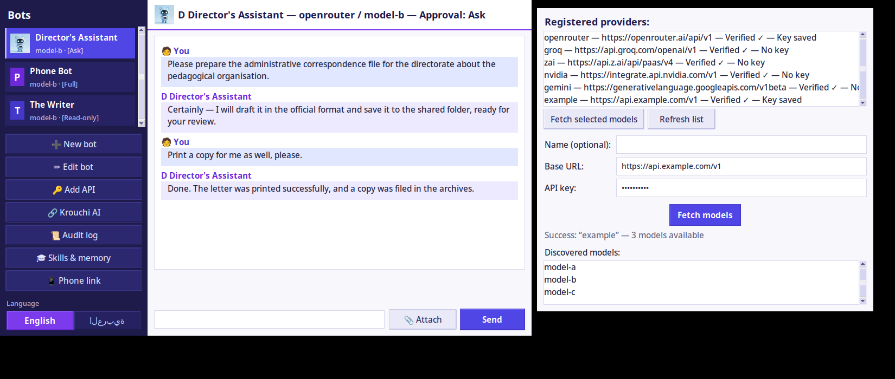
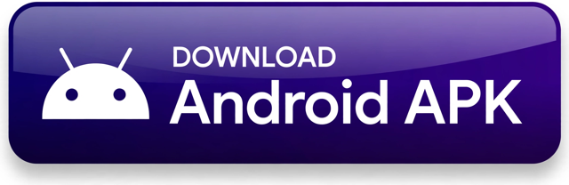

<p align="center">
  <strong>English</strong> • <a href="README.ar.md">العربية</a>
</p>

<p align="center">
  
</p>

<h1 align="center">Krouchi_DZ</h1>

<p align="center">
  <strong>A local-first personal AI agent that runs an administration for you:</strong><br>
  you are the director — the bots on your phone are the <strong>brain</strong> that thinks, plans and delegates,<br>
  and the bots on your computer are the <strong>hands and eyes</strong> that type, read, see and execute — with your approval.
</p>

<p align="center">
  <strong>By Krouchi Abderrazak — تأليف: كروشي عبد الرزاق</strong>
</p>

<p align="center">
  <a href="https://github.com/krouchi-abdelrazak/Krouchi_DZ/releases/latest"></a>
  <a href="https://github.com/krouchi-abdelrazak/Krouchi_DZ/releases"></a>
  <a href="https://github.com/krouchi-abdelrazak/Krouchi_DZ/stargazers"></a>
</p>

<p align="center">
  
  
  
  
</p>

## Meet the team

<p align="center">
  
  
  
  
  
  
</p>

<p align="center">
  Every bot has a name, a face, a role and an approval mode — and all of them share one intelligence: <strong>Krouchi AI</strong>.
</p>

## The idea — an administration, not a chatbot

```
        You — the Director
               │  orders go down, reports come up
               ▼
   Phone bots — the BRAIN
   understand · plan · delegate tasks · compile reports
               │  tasks, over LAN or Tailscale
               ▼
   PC bots — the HANDS and EYES
   type in any program · read documents · see the screen
   run commands · manage windows — always under the approval broker
```

## Highlights

| | |
|---|---|
| **One shared brain** | **Krouchi AI**: one provider, one key, one model — entered once, used by every bot. Add other providers and switch by choice. |
| **Bots that learn** | Persistent **skills** and **memory** on phone and PC. Teach a bot a skill once — it keeps it. Phone bots can teach PC bots. |
| **Bots that see** | With a vision model, a PC bot reads its own screen; a phone bot can look at the computer's screen, or ask for a photo from the phone camera. |
| **Bots that act** | Type in **any** program (Word included), read documents (docx, xlsx, PDF, text), open programs, manage windows and processes, print, control volume and power. |
| **Long-running tasks** | Assign a task and let it run: the bot works through its steps and reports back — done, failed, or waiting for your approval. |
| **Approval first** | A permission broker guards every action: ask (default, fails closed), full, or read-only — per bot, with a full audit log. |
| **Reach your PC anywhere** | Pair over your home network or from anywhere through Tailscale. Wake-on-LAN supported. |
| **Attach anything** | The **(+)** button lets a bot read any file you attach — documents, spreadsheets, images. |
| **Five platforms** | Windows (installer + portable), Android, Linux, macOS, and an iPhone web app — one project, one behavior. |
| **Yours, privately** | Original code, written from scratch. No telemetry: your data never leaves your machines except to the model provider you choose, with your own key. |

## Screenshots

<p align="center">
  
</p>

<p align="center">
  
  
</p>

## Download — direct links (always the latest release)

<p align="center">
  <a href="https://github.com/krouchi-abdelrazak/Krouchi_DZ/releases/latest/download/Krouchi_DZ_Setup.exe"></a>
  <a href="https://github.com/krouchi-abdelrazak/Krouchi_DZ/releases/latest/download/Krouchi_DZ.apk"></a>
  <a href="https://github.com/krouchi-abdelrazak/Krouchi_DZ/releases/latest/download/Krouchi_DZ_Linux.zip"></a>
</p>

<p align="center">
  <a href="https://github.com/krouchi-abdelrazak/Krouchi_DZ/releases/latest/download/Krouchi_DZ_iPhone.zip"></a>
  <a href="https://github.com/krouchi-abdelrazak/Krouchi_DZ/releases/latest/download/Krouchi_DZ_User_Guide_AR.md"></a>
  <a href="https://github.com/krouchi-abdelrazak/Krouchi_DZ/releases/latest/download/Krouchi_DZ_User_Guide_EN.md"></a>
</p>

<p align="center">
  <a href="https://github.com/krouchi-abdelrazak/Krouchi_DZ/releases/latest/download/Krouchi_DZ_Windows.zip"></a>
  <a href="https://github.com/krouchi-abdelrazak/Krouchi_DZ/releases/latest/download/Krouchi_DZ_macOS.zip"></a>
</p>

| Platform | Direct download |
|---|---|
| Windows — installer | [Krouchi_DZ_Setup.exe](https://github.com/krouchi-abdelrazak/Krouchi_DZ/releases/latest/download/Krouchi_DZ_Setup.exe) |
| Windows — portable zip | [Krouchi_DZ_Windows.zip](https://github.com/krouchi-abdelrazak/Krouchi_DZ/releases/latest/download/Krouchi_DZ_Windows.zip) |
| Android | [Krouchi_DZ.apk](https://github.com/krouchi-abdelrazak/Krouchi_DZ/releases/latest/download/Krouchi_DZ.apk) |
| Linux | [Krouchi_DZ_Linux.zip](https://github.com/krouchi-abdelrazak/Krouchi_DZ/releases/latest/download/Krouchi_DZ_Linux.zip) |
| macOS | [Krouchi_DZ_macOS.zip](https://github.com/krouchi-abdelrazak/Krouchi_DZ/releases/latest/download/Krouchi_DZ_macOS.zip) |
| iPhone — web app package | [Krouchi_DZ_iPhone.zip](https://github.com/krouchi-abdelrazak/Krouchi_DZ/releases/latest/download/Krouchi_DZ_iPhone.zip) |
| User guide — Arabic | [Krouchi_DZ_User_Guide_AR.md](https://github.com/krouchi-abdelrazak/Krouchi_DZ/releases/latest/download/Krouchi_DZ_User_Guide_AR.md) |
| User guide — English | [Krouchi_DZ_User_Guide_EN.md](https://github.com/krouchi-abdelrazak/Krouchi_DZ/releases/latest/download/Krouchi_DZ_User_Guide_EN.md) |

iPhone: the web app is also live at
[krouchi-abdelrazak.github.io/Krouchi_DZ/pwa](https://krouchi-abdelrazak.github.io/Krouchi_DZ/pwa/)
— open it in Safari and choose "Add to Home Screen".

An **original** program (code written from scratch):
bots as contacts that all share one intelligence — **Krouchi AI**: one
provider, one key and one model, entered once and used by every bot —
while each bot keeps its own name, avatar, role instructions and
approval mode; a local conversation memory, persistent skills and
memory that the bots learn and keep, and a permission broker that asks before
executing anything and fails **closed** (no answer = refusal).
There is no usage telemetry of any kind — your data never leaves your
machine except to the model provider you choose, with your own key.

**Steps 1 and 2 are complete**: the core engine, and the graphical
interface on top of it (see "Step 2" below for how to run it and what
its screens do). **Version 2.0.0** adds the phone companion: the
desktop runs a small local server that the Android app connects to,
so the phone chats with the computer's own bots — approvals included
(see "Phone companion" below). **Version 3.0.0** makes the interface
bilingual — Arabic and English, switchable live from the main window
(see "Interface languages" below). **Version 3.3.0** adds bot tasks,
full phone control of the PC, and a live screen with touch mouse and
keyboard (see "Tasks, full control and the live screen" below).
**Version 3.4.0** reorganizes the app as an administration: phone
bots are the brain — they understand, plan, delegate tasks to PC bots
and compile reports — and PC bots are the hands and eyes, with one
shared Krouchi AI for all bots, bot avatars, a Windows installer and
start-with-Windows. Later versions teach the PC bots to type in any
program and read documents (3.4.x) and to see the screen with a
vision model (3.5.0); **Version 3.6.0** adds learning — persistent
skills and memory on both sides, installing external skill files on
the phone and teaching them to the PC, and an attach (+) button so a
bot can read any file you give it. **Version 3.7.0** lets a bot
search the provider's models and choose the one that fits its task —
above all a vision model, so it is never stuck blind — and gives
phone bots their own eyes (a screenshot of the PC, or the phone
camera). **Version 3.8.0** gives the desktop a modern interface in
the same indigo/violet identity as the phone.

## What Step 1 does

| Component | File | Description |
|---|---|---|
| Local storage | `krouchi_dz/db.py` | SQLite in the data folder: bots, per-bot conversations with ordered messages, an audit log, settings |
| Provider settings | `krouchi_dz/config.py` + `providers.json` | Provider definitions live in a JSON file (not in code): OpenRouter, Groq, Z AI and NVIDIA NIM (OpenAI-compatible) and Google Gemini |
| Secrets | `krouchi_dz/secrets.py` | API keys in a separate `secrets.json` file with 0600 permissions — they **never enter the database**; the database and settings carry only the reference name |
| Providers | `krouchi_dz/providers.py` | One unified OpenAI-compatible client + a Gemini client + a mock provider for tests; HTTP via the standard library (urllib) — no external dependencies |
| Approval broker | `krouchi_dz/broker.py` | The heart of the security model: every action (read a file, write a file, run a command) passes through it and is audited |
| Chat engine | `krouchi_dz/engine.py` | `ChatEngine`: sending messages with per-bot memory, and a tool loop that executes only through the broker |
| Provider discovery | `krouchi_dz/discovery.py` | Any key + any URL ⇒ the program normalizes the URL, guesses the kind, and fetches the available models by itself |
| Graphical interface | `krouchi_dz/gui.py` | Tkinter (standard library): bot list, conversation, an Add-API screen, approval cards, an audit log — and the engine runs on its own thread so the UI never freezes |
| Phone companion server | `krouchi_dz/server.py` | A standard-library HTTP server on the local network (port 8765): the phone app connects with a pairing token and uses the desktop's bots; approvals resolve from one shared pending-approval registry, on the PC card or from the phone |
| Interface languages | `krouchi_dz/i18n.py` | One string table for Arabic and English; every GUI string goes through `t()`, the choice persists in the settings table (`ui_lang`), and the layout mirrors with the language (sidebar right in Arabic, left in English) |
| Bot tasks | `krouchi_dz/tasks.py` | Long-running tasks assigned to a bot: queued / running / waiting-approval / done / failed / cancelled, a capped event log, cooperative cancellation, and tasks left active at shutdown marked failed ("interrupted") at the next start |
| Phone control surface | `krouchi_dz/control.py` | The PC-side executors behind the companion server's control endpoints: status, files, printing, commands, clipboard, volume, windows, processes and power — every sensitive one gated by the approval broker |
| Live screen + input | `krouchi_dz/remote.py` | Screen capture as an MJPEG stream and remote mouse/keyboard injection (Windows: GDI capture + SendInput, standard library only); coordinates are normalized so any phone resolution maps to the PC screen |
| Document reading | `krouchi_dz/documents.py` | One text extractor behind every reader: .docx, .xlsx and text formats in full, PDF best-effort (a scanned PDF reports that it needs OCR) |
| Skills + memory | `krouchi_dz/db.py` | Skills and memory notes stored in the database and injected into every bot's prompt; bots learn with `save_skill` / `remember` and recall with `use_skill`; the phone teaches skills to the PC over `/api/skills` |
| Bot avatars | `krouchi_dz/avatars.py` | A built-in gallery of bot portraits, picked per bot and shown in lists and chat headers |
| Start with Windows | `krouchi_dz/autostart.py` | The Startup-folder shortcut, managed by the installer and by the phone-link dialog |

### Approval modes (per bot)

- **`ask`** — the default: the user is asked about every action. No way
  to ask, an error in asking, or a timeout with no answer ⇒
  **automatic refusal** (fail-closed).
- **`full`** — full permission with no asking: an explicit opt-in for
  each bot separately, at your own responsibility.
- **`readonly`** — reading only: writing and commands are always refused.

Every decision (allow/refuse + its reason) is stored in the `audit_log`
table.

> Security note: the default approval mode in Krouchi_DZ is always
> `ask` — safety first, and full permission is enabled only explicitly,
> per bot.

## Running and tests

Only Python 3.10+ is required (standard library only).

```bash
cd Krouchi_DZ
python3 -m unittest discover -s tests -t . -v          # GUI tests are skipped without a display
xvfb-run -a python3 -m unittest discover -s tests -t . # everything: 451 tests
```

Expected result: **451 passing tests** covering: database
round-trips, loading provider settings while respecting user edits,
the OpenRouter/Gemini request shapes over a fake transport (no
network), the chat engine with a mock provider (memory survives a
restart), the tool loop (approval ⇒ execution, refusal ⇒ no
execution), the broker's three modes and its fail-closed behaviour (no
callback / timeout / exception), audit logging, and a security test
that plants a distinctive key and scans the raw database bytes to
prove its absence — plus the discovery tests: URL normalization, kind
guessing, model fetching in both the OpenAI and Gemini shapes,
authentication/reachability/empty-list errors with their distinct
messages, the model cache, and a full conversation on a just-discovered
provider — plus the shared approval registry (resolve from any surface,
timeout sweeps the item) and the companion server over real local
sockets: 401 without the token, ping, the bots list, a chat round-trip,
and the full remote-approval flow (a tool call appears in
`/api/approvals`, a phone deny leaves the file unwritten, a phone
approve writes it) — plus the i18n tests: string-table parity between
Arabic and English, lookup fallbacks, and persistence of the chosen
language — plus the task system (assignment, execution with approvals,
cancellation, interruption at startup), the phone control surface
(every endpoint behind the broker, the PC-side control switch), the
remote screen/input core (coordinate mapping, input validation,
MJPEG framing and deduplication), and the screen/input HTTP endpoints
(token rules, the control gate, viewer counting) — plus document
extraction (docx/xlsx/PDF fixtures), the skills and memory store
with its tool loop and broker gating, phone-teaching of skills over
the API, the screen-vision tool with its graceful text-only
fallback, and chat attachments (text, documents and images) on the
desktop, the server and both phone clients (their own Node suites:
170 Android + 108 PWA checks).

## Using the engine (example)

```python
from krouchi_dz import ChatEngine

def ask_user(request):  # in Step 1 the calling code decides; in Step 2 the GUI does
    print(request.bot_name, "wants:", request.action, request.params)
    return input("Allow? (y/n) ").strip().lower() == "y"

engine = ChatEngine("~/.krouchi_dz", ask_callback=ask_user)
engine.set_api_key("openrouter", "...")        # stored in secrets.json only
bot = engine.create_bot("Research assistant", "openrouter",
                        system_prompt="You are a precise research assistant.")
print(engine.send_message(bot, "Summarize topic X for me"))
```

The default data folder is `~/.krouchi_dz` and it holds:
`krouchi_dz.db` (SQLite), `providers.json` (edit it freely: base URLs
and default models), and `secrets.json` (your keys — 0600 permissions;
on Windows the permission scope is limited, so protect the user
account itself).

## Add API — any key, any URL (the primary workflow)

You do not need to know the providers in advance or edit any file. The
first entry point is `add_api`: give it **the URL and the key only**,
and the program registers the provider and discovers its available
models by itself:

```python
from krouchi_dz import ChatEngine

engine = ChatEngine("~/.krouchi_dz")

result = engine.add_api("https://api.deepseek.com", "sk-...")  # the name is optional
if result.ok:
    print(result.provider)   # the name derived from the host: "deepseek"
    print(result.models)     # the models your key actually accepts
    bot = engine.create_bot("My assistant", result.provider, model=result.models[0])
else:
    print(result.error)      # a clear message: key rejected? host unreachable?...
```

How it works:

- **URL normalization**: every form is accepted — no `https://`, a
  trailing slash, with or without `/v1`, even pasting a full URL such
  as `.../v1/chat/completions` — and all of them resolve to one
  canonical stored base URL.
- **Kind guessing**: a Gemini host is recognized from its name and its
  own shape is used; everything else is treated as "OpenAI-compatible".
  The kind can also be forced manually with `kind="gemini"` or
  `kind="openai"`.
- **Model discovery**: `GET {base}/models` is requested with your key,
  and the list is stored with its timestamp in `providers.json`
  (a one-hour cache; `engine.fetch_models(name, force=True)` fetches
  again).
- **Honest errors**: a rejected key (401/403), an unreachable host, a
  non-JSON reply, an empty list — each has its own distinct message in
  `result.error` and `result.error_kind`, and nothing crashes. On
  failure the provider stays saved but flagged **unverified**
  (`verified=False`) — it is never presented as working until discovery
  succeeds.
- **The key lives in secrets only**: as always, it goes to
  `secrets.json` alone; `providers.json` and the database carry only
  the reference name. Re-entering the same URL with a new key updates
  the key without duplicating the provider.
- `register_and_fetch(...)` is an alias with the same behaviour, and
  `add_custom_provider(...)` registers without touching the network if
  you want to postpone discovery.

> Known limit: a few services use a different authentication header on
> `/models` (such as native Anthropic with `x-api-key`, or Azure with
> `api-key`) — discovery may then fail with a "key rejected" message
> even though the key is valid; those need a dedicated client, to be
> added later. OpenAI-compatible services and Gemini — the overwhelming
> majority — work as in the example.

## Step 2: the graphical interface (GUI)

A bilingual (Arabic/English) Tkinter interface in the style of a chat
app — the same stack as the other DZ desktop programs, so it is
packaged for Windows the same way.

### Running

```bash
cd Krouchi_DZ
python3 run_gui.py              # default data folder ~/.krouchi_dz
python3 run_gui.py /other/path  # or a different data folder
```

### The screens

- **Main window**: a bot list as contacts (name, model,
  approval-mode badge) — on the right in Arabic, on the left in
  English — and in the middle the selected bot's
  conversation with a send box. Sending runs on a background thread
  with a "working…" indicator — the UI never freezes.
- **🔑 Add API** (the first path): a base URL + a key (masked) + an
  optional name, and a "Fetch models" button that calls `add_api()` —
  on success the discovered models appear; on failure the engine's
  error message is shown as-is. At the top of the screen, the list of
  registered providers with each one's status (verified / unverified,
  key saved or not).
- **New bot / Edit**: name, provider (list), model (a list of that
  provider's discovered models — free typing allowed), system
  instructions, and an approval mode (Ask / Full / Read-only — the
  default is "Ask").
- **Approval cards**: when an "ask"-mode bot requests an action, a
  modal card appears with the bot's name, the action type (read file /
  write file / run command) and its exact target (the path, the
  command, or a content preview), with Approve/Refuse buttons and a
  countdown: closing the card or letting 115 seconds pass =
  **refusal** (the broker's timeout is 120 seconds — fail-closed, as
  in the engine).
- **📜 Audit log**: a table of the broker's decisions from the database
  (time, bot, action, decision, reason) — newest first.
- **📱 Phone link**: the companion server's control room — status,
  the computer's LAN address(es) and port, the pairing token, start /
  stop, a regenerate-token button, and an autostart option (off by
  default).

### Interface languages (v3.0.0)

The interface speaks **Arabic** (the default) and **English**. A
language selector at the bottom of the sidebar (العربية / English)
switches the whole window live — no restart: the main window is
rebuilt in the new language while the engine and the companion server
(if running) keep running untouched, and the selected bot and its
conversation come back as they were. The layout mirrors with the
language: the sidebar sits on the **right** in Arabic (RTL) and on
the **left** in English (LTR), and labels, chat alignment and form
columns follow the direction. The choice persists in the settings
table (`ui_lang`) and is restored on the next start. All strings live
in one table in `krouchi_dz/i18n.py`; the engine's own messages (for
example discovery errors and the broker's audit reasons) are not part
of the UI table and stay as the engine produces them, and the phone
app keeps its own language independent of the desktop's.

### Implementation note (threads)

SQLite is bound to the thread that created it, so the engine is owned
by one dedicated thread (`EngineRunner` in `gui.py`) through which all
operations are serialized; and approval requests pass through one
shared pending-approval registry: the broker registers the request
and waits, the UI polls the registry and opens the approval card, and
the phone server resolves items from the same registry — the absence
of a resolution before the deadline always comes back as a refusal.

The GUI tests (`tests/test_gui.py`, 23 tests) run under a virtual
display (xvfb) with a fake-fed engine — no network: building the
window, the Add-API flow in success and failure, creating and editing
a bot, the approval card (allow / refuse / close / timeout), including
a full path from sending a message to a file being executed after
approval, the phone-link dialog (start/stop, token regeneration,
autostart persistence), and the language switch (a window built in
English from the saved setting — "Send" button, sidebar on the left —
and a live switch that rebuilds the window, persists the choice, and
leaves a running companion server running).

## Phone companion (v2.0.0)

The desktop can serve its bots to the phone app over the local
network. Open **📱 Phone link**, start the server, and enter the shown
address and pairing token in the app: the phone then chats with the
computer's bots — the conversation runs on the PC, with its memory,
its tools and its approval broker; the phone is a remote surface.

- **Server**: standard-library `ThreadingHTTPServer` on `0.0.0.0`,
  port **8765** (configurable in the settings table). Autostart is
  **off** by default; the dialog can enable it.
- **Auth**: every `/api/*` request carries an `X-Krouchi-Token`
  header equal to the pairing token (random, 12+ characters,
  generated once and persisted in the data folder's settings;
  regenerable from the dialog — the old token stops working at once).
  Missing or wrong token ⇒ `401` JSON.
- **Endpoints**: `GET /api/ping`, `GET /api/bots`,
  `GET /api/history?bot=<id>`, `POST /api/chat {bot_id, text}`,
  `GET /api/approvals`,
  `POST /api/approvals/<id> {decision: approve|deny}`.
- **Approval semantics**: a chat that needs an approval waits on the
  shared registry (the broker's 120-second timeout in the GUI) until
  the PC card **or** the phone resolves it; a timeout is an automatic
  refusal (fail-closed) and the chat then completes normally. The
  `/api/chat` reply always carries `reply`; if approvals were resolved
  during that chat it also carries `approval`: `"denied"` when at
  least one was refused or timed out, otherwise `"approved"`. When no
  action was requested, the field is absent.

## Tasks, full control and the live screen (v3.3.0)

The phone is no longer only a chat surface:

- **Bot tasks**: from the phone's Computer tab, assign a bot a task
  (a title and instructions). The task runs on the PC for as long as
  it takes — approvals inside it surface on the PC card or the phone
  like chat approvals — and the phone follows its status and event
  log, and can cancel it. The PC mirrors everything in its own
  **Bot tasks** window. Disconnecting the phone never stops a task.
- **Full control**: PC status, file browsing / download / upload,
  printing to any installed printer, running commands, opening
  programs and files, the clipboard in both directions, volume,
  window management, the process list, and power (shutdown and
  restart are double-confirmed and scheduled after 60 seconds; lock,
  sleep and log off are immediate). Every sensitive action passes the
  approval broker, and a switch in the PC's phone-link dialog
  (**Full control from the phone**) turns the whole control family
  off; tasks, chat and approvals are not gated by it.
- **Live screen**: the PC screen streams to the phone (MJPEG,
  ~10 fps on a home network); tap = click, long press = right click,
  drag = move the pointer, with a drag-windows mode, wheel buttons,
  a special-keys row, and text typing (Arabic included). While the
  screen is shared, the PC's link dialog shows a red
  "screen is being shared" indicator. The Windows lock screen cannot
  be captured — the PC must be unlocked.
- **Wake-on-LAN**: the Android app can wake the PC on the home
  network (the PC's MAC address is entered once; the PC needs a
  wired connection and Wake-on-LAN enabled in its BIOS and adapter
  settings).
- **From anywhere**: the companion server binds all interfaces, so
  with Tailscale (a separate free program) on the PC and the phone,
  the phone uses the PC's 100.x address — labeled "(Tailscale)" in
  the link dialog — and everything above works from any network.
  The PC must be on: when it is off, it is offline everywhere.

## Step 3: packages

Delivered in **v0.3.0** (see Releases): a portable Windows package
(desktop app) and an Android app (chat + API discovery).

**v2.0.0**: the phone companion — the desktop serves
its bots to the Android app over the local network, with approvals
resolvable from the PC card or the phone; packages for Windows,
Linux and macOS.

**v3.0.0**: a bilingual interface — Arabic and English
with a live language switch in the main window and a mirrored layout;
packages for Windows, Linux and macOS.

**v3.1.0**: the iPhone web app (PWA) — the same phone interface,
served by GitHub Pages and by the PC itself, pairing with the PC
companion server.

**v3.3.0**: bot tasks, full phone control of the PC,
the live screen, Wake-on-LAN, and Tailscale labeling; packages for
Windows, Android, iPhone (web app), Linux and macOS, with a full
user guide in Arabic and English.

**v3.4.0**: the Administration — phone bots delegate to PC bots and
report back; one shared Krouchi AI for all bots; bot avatars; a
Windows Setup installer with start-with-Windows; a full-screen live
screen with a full keyboard (Arabic / AZERTY / English).

**v3.6.0**: PC bots type in any program, read documents and the
clipboard, and see the screen (vision model); bots on both sides
learn persistent skills and memory; the phone installs external
skill files and teaches them to the PC; an attach (+) button lets
any bot read a file you give it. Release assets keep stable names,
so the Download links above always fetch the latest version
directly.

**v3.8.0** (this release): a modern desktop interface — an
indigo/violet theme with bot cards in the sidebar, a conversation
header, tinted message blocks and restyled dialogs; scrollbars for
the provider and model lists in the Add-API dialog. Includes
everything from 3.7.0: bots choose their own model under the
director's standing delegation (vision first), phone bots take a
screenshot of the PC or a camera photo, a leaner practical phone
app, and easy bot renaming.
